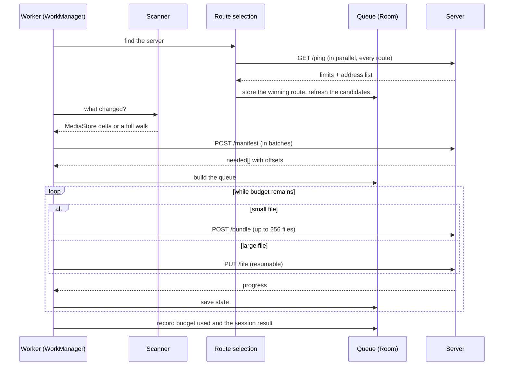

# Filum - architecture

A descriptive document. [PROTOCOL.md](PROTOCOL.md) and [PATH-RULES.md](PATH-RULES.md) are the
normative ones; this describes the module breakdown, the flows and the build order.

---

## 1. Overview

```
┌──────────────────────────────┐        ┌───────────────────────────────┐
│  Android (Kotlin, Compose)   │        │  Windows (.NET 9)             │
│                              │        │                               │
│  scan → queue → upload       │  mTLS  │  Kestrel → storage            │
│                              │ ─────► │                               │
│  Room: state, journal, routes│  HTTP  │  disk = source of truth       │
└──────────────────────────────┘        └───────────────────────────────┘
         │                                          │
         │ mDNS / overlay network                   │ tray icon
         └──────────  route selection  ─────────────┘ + browser panel
```

Data flows in one direction only. The server initiates nothing - it is a passive receiver.
All of the decision logic (what to send, when, over which route) lives on the phone.

---

## 2. Server (.NET 9)

### 2.1 Project breakdown

| Project | Responsibility | Depends on |
|---|---|---|
| `Filum.Protocol` | DTOs, `PathRules`, protocol constants | nothing - a pure library, no I/O |
| `Filum.Core` | storage engine: manifest, chunks, versions, orphans, space policy, integrity ledger | `Filum.Protocol` |
| `Filum.Server` | Kestrel, HTTP resources, mTLS, pairing, mDNS, Blazor panel | `Filum.Core` |
| `Filum.Tray` | system tray icon, context menu | `Filum.Protocol` and the local API |
| `Filum.Protocol.Tests` | path vectors, shared with the Android client | `Filum.Protocol` |
| `Filum.Core.Tests` | storage engine, security, integrity, API integration tests | all of the above |

`Filum.Protocol` is deliberately dependency-free and performs no file operations - this is
what lets `PathRules` be tested against the vectors in `paths.tsv` in isolation, and makes
the class a mirror image of the `:core:protocol` module on the Android side.

### 2.2 Key types in `Filum.Core`

- `ManifestResolver` - answers `POST /manifest`. For each entry it does a `stat()` and
  compares `(size, mtime)`. It **keeps no index** (ADR-003). In thorough mode it also
  compares the reported digest against the ledger.
- `TransferStore` - the lifecycle of `.part`/`.meta` in `.filum/incoming/`, offset
  validation, committing the transfer.
- `IntegrityLedger` - the append-only record of acceptances, chained by digests
  (protocol §9.2, ADR-016).
- `VersionStore` - files the previous content away into `.filum/versions/` (protocol §8.3).
- `OrphanReporter` - after a `mode: full` session closes, computes the difference between
  "what I have on disk" and "what arrived in the manifest".
- `SpacePolicy` - the free-space threshold, the source of `507` responses.
- `PathRules` (in `Protocol`) - sanitisation, collision detection, `index.jsonl`.

### 2.3 The tray icon and the system service

A Windows service runs in session 0 and **cannot display a UI**. That is why `Filum.Tray`
is a separate, small process that talks to the server over the same local API as the panel.
There is no special channel between them.

The build order was the reverse of the target arrangement:

- **First stage** - a single process started at logon: Kestrel and the tray icon together.
  Simpler to start and to debug.
- **Second stage** - the split: the server as a service (`UseWindowsService()`), the tray as
  an API client. Only then does the backup work with no user logged in.

The panel is Blazor and lives in `Filum.Server`, because it uses the same state objects
directly.

### 2.4 Platform traps

- **Listening on `0.0.0.0`.** Binding to a single address kills either the LAN route or the
  overlay-network route.
- **The Windows firewall on all profiles.** The overlay network's adapter will most likely
  be classified as a public network. A rule created only for the private profile will work
  at home and silently stop working remotely. The installer creates the rule for Domain,
  Private and Public.
- **The `\\?\` prefix** on every file operation.
- **`Path.Combine`** discards its first argument when the second is rooted - see the note in
  [PATH-RULES.md](PATH-RULES.md) §4.

---

## 3. Client (Android, Kotlin)

### 3.1 Gradle modules

| Module | Responsibility |
|---|---|
| `:core:protocol` | DTOs, `PathRules` (mirroring `Filum.Protocol`), integrity policy, test vectors |
| `:core:crypto` | key pair in the Android Keystore, pinning `TrustManager`, key fingerprint |
| `:core:net` | OkHttp factory, route racing, binding to a `Network`, mDNS discovery |
| `:core:data` | Room: queue, journal, budget, settings |
| `:core:scan` | `MediaStore` generation counter, directory walk, exclusions |
| `:core:sync` | the engine: session, manifest, queue, upload, bundling, budget |
| `:app` | Compose navigation, screens, dependency wiring, `WorkManager` |

The `core` split is not decoration: it lets the sync engine be tested without starting the
interface, and that engine is by far the largest part of the logic. The screens live in
`:app` rather than in separate `:feature:*` modules - with four screens, the extra module
boundary would have cost more than it bought.

### 3.2 Data model (Room)

| Entity | Key fields |
|---|---|
| `PairedServer` | `id`, `label`, `serverPin`, `keyAlias`, `pairedAt` |
| `Endpoint` | `serverId`, `host`, `port`, `kind` (lan/mdns/overlay/ddns), `lastOkAt`, `lastRttMs` |
| `FileEntry` | `path` (PK), `size`, `mtime`, `state`, `bytesSent`, `attempts`, `lastError` |
| `SyncSession` | `id`, `mode`, `startedAt`, `endedAt`, `filesTotal`, `bytesSent`, `result` |
| `ScanState` | `volume`, `lastGeneration`, `lastFullScanAt` |
| `BudgetWindow` | `hourBucket`, `secondsUsed` - a rolling 24 h window (§3.5) |
| `Exclusion` | `pathPrefix`, `enabled` |
| `LogEvent` | `id`, `at`, `level`, `code`, `message` - trimmed to 200 |
| `Settings` | `schedule`, `requireCharging`, `unmeteredOnly`, `integrityPolicy` |

`FileEntry` states: `PENDING`, `IN_PROGRESS`, `DONE`, `FAILED_TRANSIENT`,
`FAILED_PERMANENT`, `SKIPPED`. Telling the two kinds of failure apart matters - without it,
a file rejected with `422` would return to the queue forever.

### 3.3 Scanning

Two paths, because a full walk over tens of thousands of files is noticeable:

**Fast path (media).** `MediaStore` exposes a `GENERATION_MODIFIED` counter. We remember the
generation from the last scan and ask, in a single query, what has changed since. For the
bulk of the content this is the difference between milliseconds and minutes.

**Full path (walk).** Run on the first scan, after a detected generation reset, and
periodically as reconciliation. Exclusions:

- `Android/data`, `Android/obb` - inaccessible since Android 11; we do not try to work around it,
- `Android/media` - **accessible**, and home to WhatsApp among others; do not exclude,
- `.thumbnails`, `.trashed-*`, `.pending-*`, application cache directories,
- the user's list from the "Folders" screen.

Both paths record `mtime` **in seconds**, normalised in one place (ADR-011).

### 3.4 Route racing

`:core:net` exposes one function: "give me a working HTTP client for this server". Inside it,
protocol §4 happens - a parallel `ping` to every candidate, first correct pin wins, the
result lands in `Endpoint` together with its response time.

Local routes are bound to a `Network` object with `TRANSPORT_WIFI` so they work despite an
active VPN. Overlay-network routes go over the default route. Both attempts run at once.

### 3.5 Scheduling and the six-hour budget

Since Android 15, a `dataSync` foreground service is limited to six hours per day. We treat
this as a push towards a sensible architecture rather than an obstacle: the work has to be
resumable at **three levels**.

1. mid-file - a byte offset (`X-Filum-Offset`),
2. mid-queue - `FileEntry` survives a restart of the process and of the phone,
3. mid-campaign - the library spread over as many cycles as it takes.

With those three in place the limit stops mattering: the `Worker` does what it can, saves
state and ends by itself.

- `PeriodicWorkRequest` with `UNMETERED` and charging constraints.
- `CoroutineWorker` plus `setForeground()` with the `dataSync` type.
- The budget is tracked in `BudgetWindow` over a rolling 24 h window, with a **hard margin**:
  we stop after 5 h, not after 5 h 55 min. Waiting for `onTimeout()` is a mistake - the
  system then kills the work at a moment of its own choosing.
- A `WifiLock` in low-latency mode for the duration of a transfer. Without it, Wi-Fi power
  saving can cut throughput several times over while the budget drains regardless.

### 3.6 Policy: connecting is not the same as transferring

Route racing means the application will almost always get through - including over cellular.
The decision to transfer is a separate layer:

| Route | Network | Behaviour |
|---|---|---|
| LAN | unmetered, phone charging | full automatic cycle |
| overlay | unmetered | full cycle, lower priority |
| any | cellular | manual "Sync now" only, with a limit and a note about the size |

The check goes through `NetworkCapabilities`, but **with an active VPN the metered flag is
often misleading**, because the tunnel inherits the underlying network's properties in a
vendor-dependent way. To be verified empirically on the target device, not taken on faith
from the documentation.

---

## 4. The sync cycle



The crucial part: **every step of the loop saves state**. Killing the process at any moment
costs at most one chunk of one file.

---

## 5. Server panel

Screens: dashboard (status, devices, storage, ledger state), pairing (QR code), orphan
report.

The panel is reachable **from loopback only**. It issues pairing tokens and shows the
contents of the backup, so exposing it on the network would let a stranger's device pair
without the computer owner knowing (ADR-010).

For the same reason the administrative resources (`/api/v1/admin/*`) are loopback-only -
they are what the tray icon, a separate process, uses.

---

## 6. Testing

- **Path vectors.** `paths.tsv` is loaded by tests on both sides. This is the main mechanism
  keeping the two implementations in agreement.
- **Engine unit tests.** `Filum.Core` and `:core:sync`, with no network and no UI.
- **Integration tests.** `MockWebServer` on the Android side; `WebApplicationFactory` with a
  substituted filesystem on the .NET side.
- **Cross-implementation conformance.** `EndToEndTest` runs the real Kotlin client against
  the real C# server over real mTLS. The unit suites check that each side does what its
  author intended; only this one checks that the intentions agree.
- **Resume scenarios.** Interruption mid-file, a file changing during transfer, a mismatched
  offset, no space left. Each has a corresponding error code in protocol §6.
- **A measurement rig** for the experimental chapter (§7).

---

## 7. Measurements for the thesis

Worth planning from the start, because some of it requires preparing data:

1. **Throughput as a function of file size** - determining the threshold below which
   `POST /bundle` pays off. Backs ADR-008 with numbers rather than a guess.
2. **Transfer parallelism** - 1 / 3 / 8 concurrent uploads.
3. **PC on Wi-Fi versus PC on cable.** When both devices are wireless, every byte crosses the
   same band twice. The difference is large and measurable.
4. **The cost of SHA-256 against library size** - hashing throughput in MB/s on the test
   device, converted into full-scan time for several library sizes. This gives the numbers
   the choice between fast and thorough mode rests on (ADR-016), instead of a single
   measurement tied to one piece of hardware.
5. **Energy per GB** under different settings.
6. **Scan time**: `MediaStore` with the generation counter versus a full directory walk.
7. **Comparison against existing tools** (Syncthing, FolderSync, Resilio) - primarily on
   semantics, not only on speed.

---

## 8. Build order

| Stage | Scope | Result |
|---|---|---|
| 1 | `Filum.Protocol` + `:core:protocol`, `PathRules`, vectors | two implementations agreeing at the hardest point |
| 2 | server: `ping`, `manifest`, `PUT`, storage, versions - over HTTP on `localhost` | a working receiver, testable with `curl` |
| 3 | client: scan, manifest, sequential upload, no foreground service | the first end-to-end transfer |
| 4 | mTLS, key pinning, QR pairing | the security model closed |
| 5 | mDNS, route racing, binding to a `Network` | works at home and remotely, with no configuration |
| 6 | `WorkManager`, foreground service, budget | runs by itself, overnight |
| 7 | tray, Blazor panel, Compose screens | a product, not a prototype |
| 8 | `bundle`, parallelism | optimisations backed by the measurements from §7 |
| 9 | `verify`, orphans, adoption mode, integrity ledger | the remaining features |
| 10 | measurements and write-up | the experimental chapter of the thesis |

Stages 1-3 give a working skeleton on which everything else can be tested. Security is
deliberately deferred to stage 4 - on `localhost`, before the first exposure to a network.
That order must not be reversed by putting a server without mTLS on an address reachable
from outside the machine.
