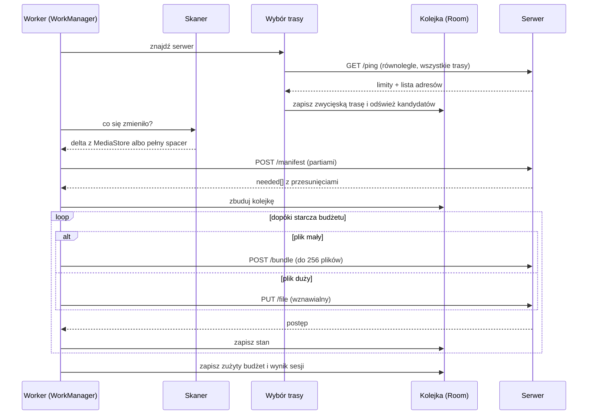

# Filum — architektura

Dokument opisowy. Normatywne są [PROTOCOL.md](PROTOCOL.md) i [PATH-RULES.md](PATH-RULES.md);
tutaj opisujemy podział na moduły, przepływy i kolejność budowy.

---

## 1. Przegląd

```
┌──────────────────────────────┐        ┌───────────────────────────────┐
│  Android (Kotlin, Compose)   │        │  Windows (.NET 9)             │
│                              │        │                               │
│  skan → kolejka → wysyłka    │  mTLS  │  Kestrel → składowanie        │
│                              │ ─────► │                               │
│  Room: stan, dziennik, trasy │  HTTP  │  dysk = źródło prawdy         │
└──────────────────────────────┘        └───────────────────────────────┘
         │                                          │
         │ mDNS / sieć nakładkowa                   │ ikona w zasobniku
         └──────────  wybór trasy  ─────────────────┘ + panel w przeglądarce
```

Ruch danych jest wyłącznie jednokierunkowy. Serwer nie inicjuje niczego —
jest pasywnym odbiorcą. Cała logika decyzyjna (co wysłać, kiedy, którą trasą)
mieszka na telefonie.

---

## 2. Serwer (.NET 9)

### 2.1 Podział na projekty

| Projekt | Odpowiedzialność | Zależności |
|---|---|---|
| `Filum.Protocol` | modele DTO, `PathRules`, stałe protokołu | brak — czysta biblioteka, bez I/O |
| `Filum.Core` | silnik składowania: manifest, fragmenty, wersje, sieroty, polityka miejsca | `Filum.Protocol` |
| `Filum.Server` | Kestrel, zasoby HTTP, mTLS, parowanie, mDNS, panel Blazor | `Filum.Core` |
| `Filum.Tray` | ikona w zasobniku systemowym, menu kontekstowe | `Filum.Protocol`, `Filum.Core` i lokalne API |
| `Filum.Tests` | testy jednostkowe i integracyjne | wszystkie |

`Filum.Protocol` jest celowo bez zależności i bez operacji plikowych — dzięki temu
`PathRules` da się testować wektorami z `paths.tsv` w izolacji, a klasa jest
lustrzanym odbiciem modułu `:core:protocol` po stronie Androida.

### 2.2 Kluczowe typy w `Filum.Core`

- `ManifestResolver` — odpowiada na `POST /manifest`. Dla każdej pozycji robi
  `stat()` i porównuje `(rozmiar, mtime)`. **Nie utrzymuje indeksu** (ADR-003).
- `TransferStore` — cykl życia `.part`/`.meta` w `.filum/incoming/`, walidacja
  przesunięć, domknięcie transferu.
- `VersionStore` — odłożenie poprzedniej zawartości do `.filum/versions/` (§8.3 protokołu).
- `OrphanReporter` — po zamknięciu sesji `mode: full` wylicza różnicę
  „co mam na dysku" minus „co przyszło w manifeście".
- `SpacePolicy` — próg wolnego miejsca, źródło odpowiedzi `507`.
- `PathRules` (w `Protocol`) — sanityzacja, wykrywanie kolizji, `index.jsonl`.

### 2.3 Ikona w zasobniku a usługa systemowa

Usługa Windows działa w sesji 0 i **nie może wyświetlać interfejsu**. Dlatego
`Filum.Tray` jest osobnym, drobnym procesem, który rozmawia z serwerem przez to
samo lokalne API co panel. Nie ma między nimi żadnego kanału specjalnego.

Kolejność budowy jest jednak odwrotna do docelowej:

- **Etap pierwszy** — jeden proces uruchamiany przy logowaniu: Kestrel + ikona
  w zasobniku razem. Prościej się uruchamia i debuguje.
- **Etap drugi** — rozdzielenie: serwer jako usługa (`UseWindowsService()`),
  zasobnik jako klient API. Dopiero wtedy backup działa również przy wylogowanym
  użytkowniku.

Panel jest w Blazorze i mieszka w `Filum.Server`, bo korzysta bezpośrednio z tych
samych obiektów stanu; postęp transferu płynie do przeglądarki przez SignalR,
więc paski postępu ruszają się bez odpytywania.

### 2.4 Pułapki platformowe

- **Nasłuch na `0.0.0.0`.** Przypięcie do jednego adresu zabije albo trasę LAN,
  albo trasę przez sieć nakładkową.
- **Zapora Windows na wszystkich profilach.** Adapter sieci nakładkowej zostanie
  najprawdopodobniej zaklasyfikowany jako sieć publiczna. Reguła założona tylko
  dla profilu prywatnego zadziała w domu i przestanie działać zdalnie, bez
  żadnego komunikatu. Instalator zakłada regułę dla Domain, Private i Public.
- **Prefiks `\\?\`** przy każdej operacji plikowej.
- **`Path.Combine`** odrzuca pierwszy argument, gdy drugi jest zakorzeniony —
  patrz uwaga w [PATH-RULES.md](PATH-RULES.md) §4.

---

## 3. Klient (Android, Kotlin)

### 3.1 Moduły Gradle

| Moduł | Odpowiedzialność |
|---|---|
| `:core:protocol` | modele DTO, `PathRules` (lustro `Filum.Protocol`), wektory testowe |
| `:core:crypto` | para kluczy w Android Keystore, `TrustManager` z przypięciem, odcisk klucza |
| `:core:net` | fabryka OkHttp, wyścig tras, przypięcie do `Network`, odkrywanie mDNS |
| `:core:data` | Room, DataStore, repozytoria |
| `:core:scan` | generacja `MediaStore`, spacer po katalogach, wykluczenia |
| `:core:sync` | silnik: sesja, manifest, kolejka, wysyłka, paczkowanie, budżet |
| `:feature:pairing` | skan QR, ręczne wprowadzenie, przebieg parowania |
| `:feature:home` | status, „Synchronizuj teraz", wybór harmonogramu |
| `:feature:folders` | wykluczenia katalogów |
| `:feature:log` | ostatnie 200 zdarzeń |
| `:app` | nawigacja Compose, wstrzykiwanie zależności, `WorkManager` |

Podział `core`/`feature` nie jest ozdobnikiem: pozwala testować silnik
synchronizacji bez uruchamiania interfejsu, a to jest zdecydowanie największa
część logiki.

### 3.2 Model danych (Room)

| Encja | Pola kluczowe |
|---|---|
| `PairedServer` | `id`, `label`, `serverPin`, `keyAlias`, `pairedAt` |
| `Endpoint` | `serverId`, `host`, `port`, `kind` (lan/mdns/overlay/ddns), `lastOkAt`, `lastRttMs` |
| `FileEntry` | `path` (PK), `size`, `mtime`, `state`, `bytesSent`, `attempts`, `lastError` |
| `SyncSession` | `id`, `mode`, `startedAt`, `endedAt`, `filesTotal`, `bytesSent`, `result` |
| `ScanState` | `volume`, `lastGeneration`, `lastFullScanAt` |
| `BudgetWindow` | `hourBucket`, `secondsUsed` — okno kroczące 24 h (§3.5) |
| `Exclusion` | `pathPrefix`, `enabled` |
| `LogEvent` | `id`, `at`, `level`, `code`, `message` — przycinane do 200 |

Stany `FileEntry`: `PENDING`, `IN_PROGRESS`, `DONE`, `FAILED_TRANSIENT`,
`FAILED_PERMANENT`, `SKIPPED`. Rozróżnienie dwóch rodzajów porażki jest istotne —
bez niego plik odrzucony przez `422` wracałby do kolejki w nieskończoność.

### 3.3 Skanowanie

Dwie ścieżki, bo koszt pełnego spaceru po ~100 tys. plików jest odczuwalny:

**Ścieżka szybka (media).** `MediaStore` udostępnia licznik `GENERATION_MODIFIED`.
Zapamiętujemy generację z ostatniego skanu i pytamy jednym zapytaniem o to, co
zmieniło się od tego czasu. Dla zdecydowanej większości zawartości daje to różnicę
w milisekundach zamiast w minutach.

**Ścieżka pełna (spacer).** Uruchamiana przy pierwszym skanie, po wykryciu resetu
generacji i cyklicznie jako rekoncyliacja. Wykluczenia:

- `Android/data`, `Android/obb` — niedostępne od Androida 11, nie próbujemy obchodzić,
- `Android/media` — **dostępne**, tu mieszka m.in. WhatsApp; nie wykluczać,
- `.thumbnails`, `.trashed-*`, `.pending-*`, katalogi podręczne aplikacji,
- lista użytkownika z ekranu „Foldery".

Obie ścieżki zapisują `mtime` **w sekundach**, znormalizowane w jednym miejscu
(ADR-011).

### 3.4 Wyścig tras

`:core:net` wystawia jedną funkcję: „daj mi działającego klienta HTTP do tego
serwera". W środku dzieje się §4 protokołu — równoległy `ping` do wszystkich
kandydatów, wygrywa pierwszy z poprawnym pinem, wynik trafia do `Endpoint`
razem z czasem odpowiedzi.

Trasy lokalne są przypinane do obiektu `Network` z `TRANSPORT_WIFI`, żeby
działały mimo aktywnego VPN. Trasy przez sieć nakładkową idą trasą domyślną.
Obie próby lecą jednocześnie.

### 3.5 Harmonogram i budżet 6 godzin

Usługa pierwszoplanowa typu `dataSync` ma od Androida 15 limit 6 godzin na dobę.
Traktujemy to jako wymuszenie sensownej architektury, a nie przeszkodę: praca
musi być wznawialna na **trzech poziomach**.

1. w środku pliku — przesunięcie bajtowe (`X-Filum-Offset`),
2. w środku kolejki — `FileEntry` przeżywa restart procesu i telefonu,
3. w środku kampanii — biblioteka rozłożona na tyle cykli, ile potrzeba.

Mając te trzy, limit przestaje mieć znaczenie: `Worker` robi tyle, ile zdąży,
zapisuje stan i kończy się sam.

- `PeriodicWorkRequest` z ograniczeniami `UNMETERED` + ładowanie.
- `CoroutineWorker` + `setForeground()` z typem `dataSync`.
- Budżet liczony w `BudgetWindow` w oknie kroczącym 24 h, z **twardym marginesem**:
  kończymy po 5 h, nie po 5 h 55 min. Czekanie na `onTimeout()` jest błędem —
  system ubija wtedy pracę w nieokreślonym momencie.
- `WifiLock` w trybie niskich opóźnień na czas transferu. Bez niego oszczędzanie
  energii karty Wi-Fi potrafi wielokrotnie ściąć przepustowość, a budżet i tak leci.

### 3.6 Polityka: połączyć się to nie to samo, co przesłać

Wyścig tras sprawia, że aplikacja dodzwoni się prawie zawsze — także przez sieć
komórkową. Decyzja o transferze jest osobną warstwą:

| Trasa | Sieć | Zachowanie |
|---|---|---|
| LAN | nielimitowana, telefon się ładuje | pełny cykl automatyczny |
| nakładkowa | nielimitowana | pełny cykl, niższy priorytet |
| dowolna | komórkowa | wyłącznie ręczne „Synchronizuj teraz", z limitem i informacją o rozmiarze |

Sprawdzenie idzie przez `NetworkCapabilities`, ale **przy aktywnym VPN raportowanie
limitowania bywa mylące**, bo tunel dziedziczy właściwości sieci pod spodem
w sposób zależny od producenta. Do zweryfikowania empirycznie na urządzeniu
docelowym, nie do przyjęcia na wiarę z dokumentacji.

---

## 4. Przepływ cyklu synchronizacji



Kluczowe: **każdy krok pętli zapisuje stan**. Zabicie procesu w dowolnym momencie
kosztuje najwyżej jeden fragment pliku.

---

## 5. Panel serwera

Ekrany: pulpit (status, bieżący transfer, przepustowość), urządzenia (lista,
parowanie kodem QR, wyłączenie, usunięcie), składowanie (zajętość per urządzenie,
wolne miejsce, katalog główny), przeglądarka wersji, raport sierot, dziennik,
ustawienia (port, katalog, progi, tryb adopcji).

Panel jest dostępny **wyłącznie z pętli zwrotnej**. Wydaje tokeny parowania
i pokazuje zawartość kopii, więc udostępnienie go w sieci pozwalałoby obcemu
urządzeniu sparować się bez wiedzy właściciela komputera (ADR-010).

Z tego samego powodu z pętli zwrotnej dostępne są też zasoby administracyjne
(`/api/v1/admin/*`) — korzysta z nich ikona w zasobniku, będąca osobnym procesem.

---

## 6. Testowanie

- **Wektory ścieżek.** `paths.tsv` ładowany przez testy po obu stronach. To jest
  główny mechanizm utrzymujący dwie implementacje w zgodzie.
- **Testy jednostkowe silnika.** `Filum.Core` i `:core:sync` bez sieci i bez UI.
- **Testy integracyjne.** Po stronie Androida `MockWebServer`; po stronie .NET
  `WebApplicationFactory` z podstawionym systemem plików.
- **Scenariusze wznawiania.** Przerwanie w połowie pliku, zmiana pliku w trakcie
  transferu, niezgodne przesunięcie, brak miejsca. Każdy ma odpowiadający kod
  błędu w §6 protokołu.
- **Stanowisko pomiarowe** do rozdziału eksperymentalnego (§7).

---

## 7. Materiał pomiarowy do pracy

Eksperymenty warto zaplanować od początku, bo część wymaga przygotowania danych:

1. **Przepustowość w funkcji rozmiaru pliku** — wyznaczenie progu, poniżej którego
   opłaca się `POST /bundle`. Uzasadnia ADR-008 liczbami, a nie przypuszczeniem.
2. **Równoległość transferów** — 1 / 3 / 8 jednoczesnych wysyłek.
3. **PC na Wi-Fi kontra PC na kablu.** Gdy oba urządzenia są bezprzewodowe, każdy
   bajt przechodzi przez to samo pasmo dwukrotnie. Różnica jest duża i mierzalna.
4. **Koszt SHA-256 wobec rozmiaru biblioteki** — przepustowość hashowania w MB/s
   na urządzeniu testowym, przeliczona na czas pełnego skanu dla kilku rozmiarów
   biblioteki. Daje liczby, na których opiera się wybór między trybem szybkim
   a dokładnym (ADR-016), zamiast pojedynczego pomiaru przywiązanego do jednego
   egzemplarza sprzętu.
5. **Zużycie energii na GB** przy różnych ustawieniach.
6. **Czas skanu**: `MediaStore` z generacją kontra pełny spacer po katalogach.
7. **Porównanie z istniejącymi narzędziami** (Syncthing, FolderSync, Resilio) —
   przede wszystkim pod kątem semantyki, nie tylko szybkości.

---

## 8. Kolejność budowy

| Etap | Zakres | Efekt |
|---|---|---|
| 1 | `Filum.Protocol` + `:core:protocol`, `PathRules`, wektory | dwie implementacje zgodne w najtrudniejszym miejscu |
| 2 | serwer: `ping`, `manifest`, `PUT`, składowanie, wersje — po HTTP na `localhost` | działający odbiornik, testowalny `curl`-em |
| 3 | klient: skan, manifest, wysyłka sekwencyjna, bez usługi pierwszoplanowej | pierwszy transfer end-to-end |
| 4 | mTLS, przypięcie kluczy, parowanie kodem QR | model bezpieczeństwa domknięty |
| 5 | mDNS, wyścig tras, przypięcie do `Network` | działa w domu i zdalnie, bez konfiguracji |
| 6 | `WorkManager`, usługa pierwszoplanowa, budżet | działa samo, nocami |
| 7 | zasobnik, panel Blazor, ekrany Compose | produkt, nie prototyp |
| 8 | `bundle`, równoległość | optymalizacje poparte pomiarami z §7 |
| 9 | `verify`, sieroty, tryb adopcji | funkcje uzupełniające |
| 10 | pomiary i opis | rozdział eksperymentalny pracy |

Etapy 1–3 dają działający szkielet, na którym można testować wszystko pozostałe.
Świadomie odkładamy bezpieczeństwo do etapu 4 — na `localhost`, przed pierwszym
wyjściem w sieć. Nie wolno tej kolejności odwrócić i wypuścić serwera bez mTLS
na adres osiągalny spoza komputera.
